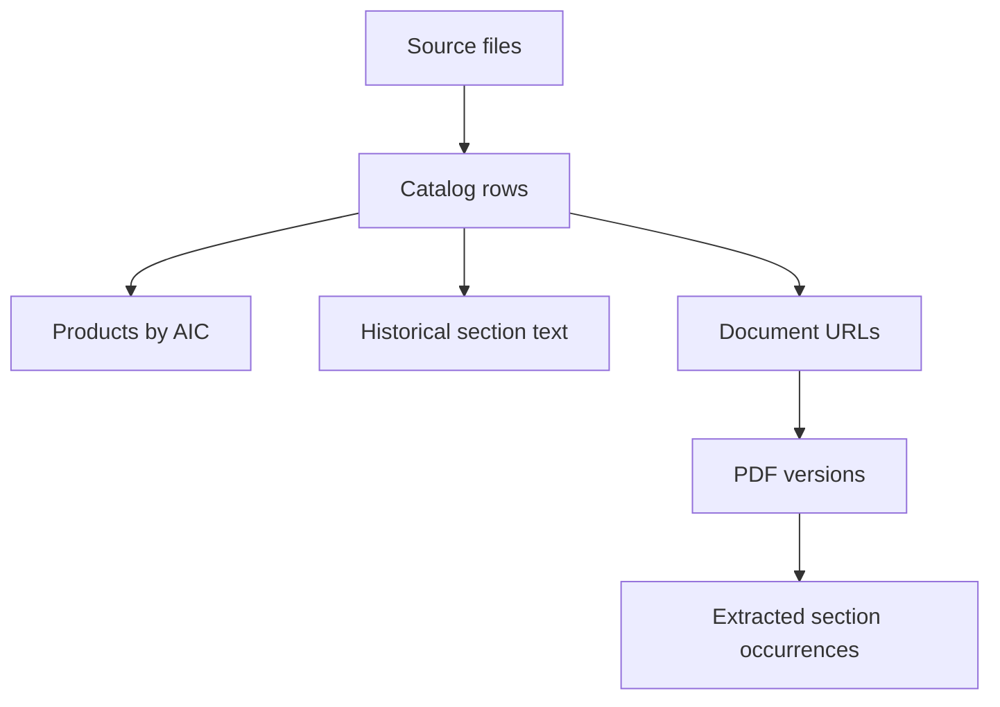

# AIFA Pharmaceutical Document Pipeline

A Python and SQLite project for validating a local medicine catalog and extracting ten numbered sections from AIFA product-information PDFs. It preserves nine-digit AIC identifiers, keeps source rows traceable and separates historical spreadsheet text from fresh PDF extraction. Google Sheets export is optional.

[CI checks](https://github.com/Parisa6Izadyar/SQL_AIFA/actions/workflows/tests.yml) · [SQL queries](sql/) · [Methods](docs/methodology.md) · [Recorded run](results/benchmark/metrics.json)

## Run in Codespaces

[Open in GitHub Codespaces](https://codespaces.new/Parisa6Izadyar/SQL_AIFA?ref=main)

Select the pull request branch when reviewing changes. The dev container uses Python 3.12. Run the installation command below if setup has not finished or the Codespace was created before changing branches.

```bash
python -m pip install -r requirements.txt
python -m pytest -q
python -m aifa_pipeline build
```

The build uses the checked-in CSV and needs no network connection or credentials after installation. It creates `results/reproduced/aifa.sqlite`, six CSV reports and `metrics.json`, then prints `Finished. Results: ...`.

To download and parse the first two eligible PDF URLs:

```bash
python -m aifa_pipeline extract --limit 2
```

This step needs access to the public AIFA endpoint. Downloads have timeouts, bounded retries, a size limit and a SHA-256 checked cache. Repeated runs reuse PDFs; `--refresh` downloads them again. Unavailable URLs are recorded as failures and return a nonzero exit code without deleting previous extraction results. Conflicting catalog records are excluded from automatic extraction.

## Local setup

Tested on Python 3.12 on Linux:

```bash
python -m venv .venv
source .venv/bin/activate
python -m pip install -r requirements.txt
python -m pytest -q
python -m aifa_pipeline build
```

On Windows, activate with `.venv\Scripts\activate`; Windows is not covered by CI. The original entry point also works: `python src/main.py build`. Use `--help` for command options. An alternative input and output directory can be supplied with `--input` and `--output`.

## Verified scope

The bundled CSV is a historical project sample, not the complete or current AIFA registry.

| Catalog measurement | Count |
| --- | ---: |
| Source rows retained | 332 |
| Distinct AIC package identifiers | 331 |
| Distinct active-ingredient labels | 58 |
| Rows with a valid-format PDF URL | 320 |
| Distinct valid-format PDF URLs | 148 |
| Rows without a usable PDF URL | 12 |
| AIC identifiers flagged for metadata/link review | 2 |
| Historical section cells marked as truncated | 9 |

All source AIC values need leading-zero restoration to reach nine digits. The raw values remain available. One AIC has conflicting authorization-holder names across two rows. Another row links `ARTANE` to a PDF for `Nadixa`; its URL/AIC-prefix discrepancy is flagged rather than corrected by guessing. See [data quality notes](docs/data_quality.md).

A local live run on 30 October 2026 downloaded **two PDFs covering 76 pages**. The parser retained **70 section occurrences**, with all ten target section types present in both documents. Four linked package AICs were found in their PDF text. These counts describe this small run and do not measure extraction accuracy. The PDFs contain multiple formulations, so repeated sections remain separate with page ranges.

The automated suite has **33 tests**. CI builds the actual bundled catalog and tests the parser with synthetic PDFs; it does not download live AIFA documents or contact Google Sheets. The [validation record](docs/validation.md) distinguishes these checks.

## SQL model and reports

SQLite is part of Python; no database server is required. [schema.sql](sql/schema.sql) defines primary keys, foreign keys, unique constraints and indexes. Source rows are retained even when AIC identifiers repeat.



The six report queries cover catalog totals, historical section availability, document reuse across packages, data issues, fresh extraction coverage and ingredient counts. Rebuild reports from an existing database with:

```bash
python -m aifa_pipeline report
```

For example, this query counts source rows and distinct package identifiers per shared PDF URL:

```sql
SELECT document_url, COUNT(*) AS source_rows, COUNT(DISTINCT aic) AS unique_aic
FROM catalog_rows
WHERE document_url IS NOT NULL
GROUP BY document_url
ORDER BY unique_aic DESC;
```

## Google Sheets export

The local workflow does not require a Google account. An optional exporter can update an existing worksheet after fresh PDF extraction:

```bash
python -m pip install -r requirements-sheets.txt
export GOOGLE_APPLICATION_CREDENTIALS=/path/to/local/service_account.json
python -m aifa_pipeline sheets-export \
  --spreadsheet-id YOUR_SPREADSHEET_ID --worksheet Data
```

This command reads the worksheet and writes a **local preview** to `results/sheets_plan.json`. Inspect that file before repeating the command with `--apply`. Share the intended spreadsheet with the service account before using the exporter. Keep credential files outside Git.

The exporter matches normalized AIC identifiers, accepts Italian or English section-column titles, uses batched RAW cell updates and preserves unrelated cells. It skips failed or ambiguous documents, absent sections, texts over 49,000 characters and documents with repeated section headings. It does not overwrite previous cells with failure markers. See [the export rules](docs/methodology.md#google-sheets) before applying changes. A live Google Sheets write has not been tested; behavior is covered with a fake client.

## Files

- `aifa_pipeline/`: catalog validation, PDF parsing, download/cache, SQLite storage, reporting and optional export.
- `sql/`: schema and six report queries.
- `tests/`: regression and integration checks.
- `data/`: original project files; [input notes](data/README.md) explain which snapshot the default run uses.
- `results/benchmark/`: small checked-in summaries of the verified run. Local databases, cached PDFs and fresh reports are ignored by Git.

## Sources and limits

AIFA describes the RCP as approved product information that can change over time: [RCP and package leaflets](https://www.aifa.gov.it/riassunto-caratteristiche-e-foglio-illustrativo), [AIFA medicine search](https://medicinali.aifa.gov.it/). Its [AIC guidance](https://www.aifa.gov.it/it/certificati-di-prodotto-farmaceutico-con-aic) uses nine-digit package identifiers.

This project stores regulatory text for data-processing research. It does not infer clinical recommendations, verify medical statements or establish that a historical link is current. A PDF may cover several formulations, and literal AIC presence alone does not identify the applicable paragraph. Tables are extracted as text; complex layouts, scanned pages and unrecognized headings need manual review. No OCR or clinical accuracy score is claimed.
